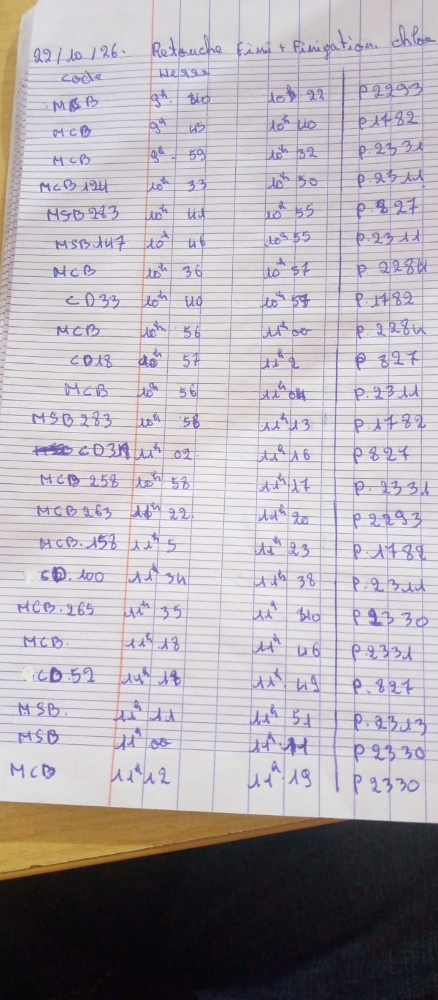
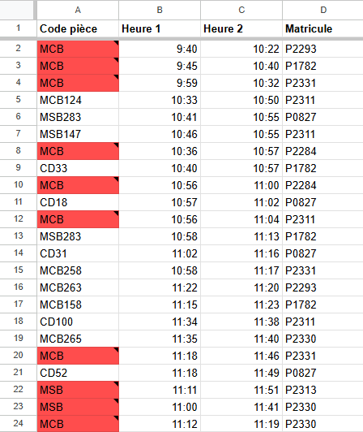
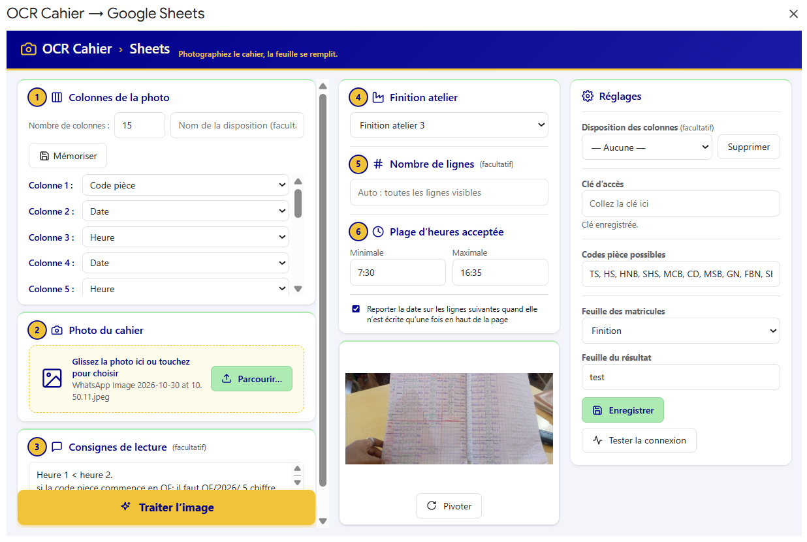

# 📓 OCR Cahier → Google Sheets

> Photographier un cahier manuscrit d'atelier → obtenir un tableau Google Sheets propre, **contrôlé automatiquement**.
> **100 % gratuit** : Google Apps Script + API Gemini (offre gratuite). Aucun serveur, aucun abonnement.

---

## 🎯 Problème

En atelier de fabrication (production de luxe), le suivi se fait à la main dans un cahier : code pièce, heures, matricule de l'ouvrier. La saisie manuelle dans Excel est lente et source d'erreurs.

## ✅ Solution

Une interface intégrée à Google Sheets : on prend la photo, l'IA lit l'écriture manuscrite, le script **valide chaque valeur** et signale les doutes en rouge.

| 📷 Photo du cahier (prise au téléphone) | 📊 Résultat dans Google Sheets |
|:---:|:---:|
|  |  |

*Les cellules rouges = valeur illisible ou invalide, avec une note qui explique pourquoi.*

---

## 🖥️ L'interface



*Tout se fait dans une seule fenêtre : colonnes, photo, consignes, finition, lancement et réglages.*

---

## ✨ Fonctionnalités

- **Colonnes configurables** (1 à 30) : Date, Heure, Matricule, Code pièce, Texte, Ignorer
- **Dispositions mémorisables** : on enregistre une mise en page de cahier sous un nom et on la réutilise
- **Consignes libres** pour guider l'IA selon la photo
- **Contrôles automatiques** :
  - date ≤ aujourd'hui, heure dans une plage définie
  - code pièce valide (préfixes TS, HS, HNB… configurables)
  - matricule `P` + 4 chiffres, vérifié dans la liste de la finition choisie (et suggestion du matricule le plus proche)
- **Cellules douteuses en rouge** + note explicative
- Report automatique de la date écrite une seule fois en haut de page
- Rotation de la photo, aperçu, glisser-déposer

## 💸 Coût : 0 €

| Brique | Rôle | Coût |
|---|---|---|
| Google Sheets + Apps Script | Interface, logique, écriture | Gratuit |
| API Gemini (Google AI Studio) | Lecture de l'écriture manuscrite (OCR) | Gratuit (offre gratuite, avec quotas) |
| Hébergement / serveur | — | Aucun besoin |

## 🧱 Architecture

```
Téléphone/PC ──► Interface HTML (Apps Script)
                      │
                      ▼
              Code.gs : traiterImage()
               ├─ appel API Gemini (image → JSON)
               ├─ validation (dates, heures, codes, matricules)
               └─ écriture dans la feuille « Résultat » (+ rouge + notes)
```

Fichiers :
- `Code.gs` — logique serveur (OCR, validation, écriture)
- `Interface.html` — interface utilisateur

---

## 🚀 Installation (5 minutes)

1. **Clé Gemini gratuite** : aller sur [Google AI Studio](https://aistudio.google.com/apikey) → *Create API key*.
2. Ouvrir votre Google Sheets → **Extensions → Apps Script**.
3. Coller `Code.gs` dans le fichier de script, puis créer un fichier HTML nommé **`Interface`** et y coller `Interface.html`.
4. Créer une feuille **`Finition`** : colonne A = matricules, colonne B = finition atelier.
5. Recharger le Sheets → menu **OCR Cahier → Ouvrir l'interface**.
6. Dans *Réglages* : coller la clé → **Enregistrer** → **Tester la connexion**.
7. Choisir colonnes + finition, charger la photo, cliquer **Traiter l'image**.

## 🛠️ Technologies

Google Apps Script (JavaScript) · HTML/CSS · API Gemini · Google Sheets

## 👤 Auteur

**Nambinintsoa (Tsiory) Burleigh** — Suivi de production, automatisation, analyse de données et agents IA.
Antananarivo, Madagascar.

> ⚠️ Code source privé. Démonstration et accès au code sur demande.
